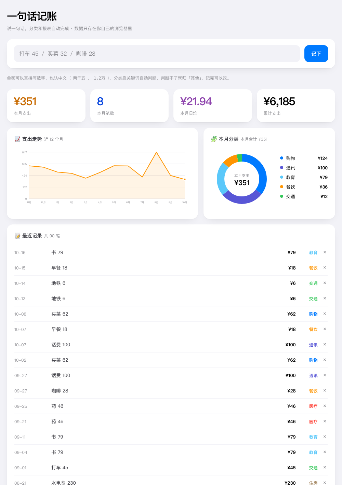

# 一句话记账 · One-line Ledger

> 记账 App 我记三天就停，试过五六个都一样。后来想明白死因不在懒，在成本结构。

这个工具把「填表」那一步删掉了——你只负责说一句话，分类和报表全部自动完成。



---

## 为什么是「说一句话」

传统记账 App 的死因都一样：**要你填表**。金额、分类、日期、账户，一笔要选四五次。一笔十来秒，一天五笔就是一分钟——靠意志力撑一个月的事，早晚会停。

这里只做一件事：把每笔的操作压到只剩一句话。

```
打车 45        →  交通    ¥45
买菜 62        →  购物    ¥62
水电费 230     →  住房    ¥230
咖啡 28        →  餐饮    ¥28
昨天 加油 300  →  交通    ¥300（自动记到昨天）
```

---

## 怎么用

### 方式一：接你自己的 AI Agent（推荐，真正的「口喷记账」）

最省事也最耐用的用法：把这个仓库的链接发给你自己的 AI Agent（Hermes / Claude Code / Cursor 之类），说一句「帮我装这个记账」。它会照着 [AGENT.md](AGENT.md) 自己装好、并把用法写进自己的长期记忆——**那份文件就是写给 Agent 看的**。

之后你只需要说话：「打车 45」「买菜 32」「昨天加油 300」。账记完了，数据落在你电脑上的一个 SQLite 文件里，随时能拷走。日常使用不碰命令行、不打开任何页面。

### 方式二：不想装任何东西，直接开网页

直接访问：**https://pixel6068.github.io/one-line-ledger/**

页面打开就是一个能用的账本，不用下载、不用安装。想先看效果，可以在页面里点「载入示例数据」。

### 方式三：下载网页版单文件本地用

把 `index.html` 下载到本地，双击就能用。**整个工具就是一个 HTML 文件**，没有任何依赖、不联网、不需要装 Python 或 Node。

### 方式四：命令行直接用

不想接 Agent 也行，三条命令就够了：

```
python3 ledger.py add "打车 45"     # 记一笔
python3 ledger.py list              # 看最近记录
python3 ledger.py stats             # 本月汇总
python3 ledger.py report            # 生成 HTML 报表
```

只用 Python 标准库，不需要装任何包。数据在 `~/.one-line-ledger/ledger.db`。
金额支持 `45` / `45元` / `1.2万` / `两千五` / `$20`；句子里带「昨天」「前天」会自动记到那一天。

---

## 它怎么工作

两种用法共用同一套解析和分类逻辑，只是数据落点不同：

```
你说一句话
    ↓
解析金额    45 / 45元 / 1.2万 / 两千五 / $20（按汇率折算）
    ↓
判断分类    前置规则 → 关键词表 → 兜底「其他」
    ↓
写入本地    ├─ 接 Agent 或命令行 → ~/.one-line-ledger/ledger.db（SQLite 文件）
            └─ 网页版            → 浏览器的 localStorage
    ↓
出报表      本月 KPI → 12 个月走势 → 本月分类 → 记录列表
```

⚠️ 两条路径的数据**不互通**，按你选的方式固定用其中一套就好。

---

## 分类规则可以自己改

打开 `index.html`，找到脚本开头的这两块：

**关键词表 `CATS`** — 每个分类对应一组词，命中即归类。想加「宠物」分类，就往里加一组词即可。

**前置规则 `PRE`** — 优先于关键词表执行，用来处理「关键词会互相抢」的情况。例如：

```js
[/买菜|菜市场|生鲜/, "购物"],        // 在超市买的菜算购物，不算餐饮
[/水费|电费|燃气费|取暖费/, "住房"]
```

这条规则很关键：**按支付场景分类，不要按物品分类**。同一样东西换个渠道就是另一个类目，人每天手动判断的结果是不稳定的，最后统计一定是一锅粥。

---

## 弊端与限制

这些是它做不到的事，提前说清楚：

1. **数据存在浏览器里，换设备或清缓存会丢。** 存的是 localStorage，不上传服务器（这是隐私优势，也是它的脆弱点）。换电脑、换浏览器、清理缓存、重装系统都会丢。**养成定期点「导出 JSON」的习惯。**
2. **手机上尤其要小心。** iOS Safari 对长期不访问的站点会清理本地存储，手机版只建议当随手记，正式账本请用电脑。
3. **分类是关键词规则，不是 AI。** 常见说法没问题，但中文表达千变万化，遇到规则没覆盖的说法会归到「其他」。这是浏览器版的取舍——想要更聪明就得走上面的「方式三」。
4. **只记支出，不记收入。** 定位是「看清钱花在哪」，不是完整的财务系统。
5. **不是专业记账软件。** 没有复式记账、没有对账、没有发票管理、没有多账户、没有预算提醒。要做这些请用专业工具，这个工具解决的是「记不下来」的问题，不是「记不专业」的问题。
6. **没有多人协作。** 一个浏览器一份账本。
7. **删除不可撤销。** 点记录后面的 × 就直接删了，没有回收站。

---

## 数据与隐私

- 所有记录只存在你自己的浏览器 localStorage 里，**不发送到任何服务器**（页面本身都没有网络请求）
- 想带走或备份：点「导出 JSON」，得到一个纯文本文件
- 想迁移到别处：在新设备点「导入 JSON」
- 想彻底清除：点「清空」，或在浏览器里清站点数据

---

## License

MIT
